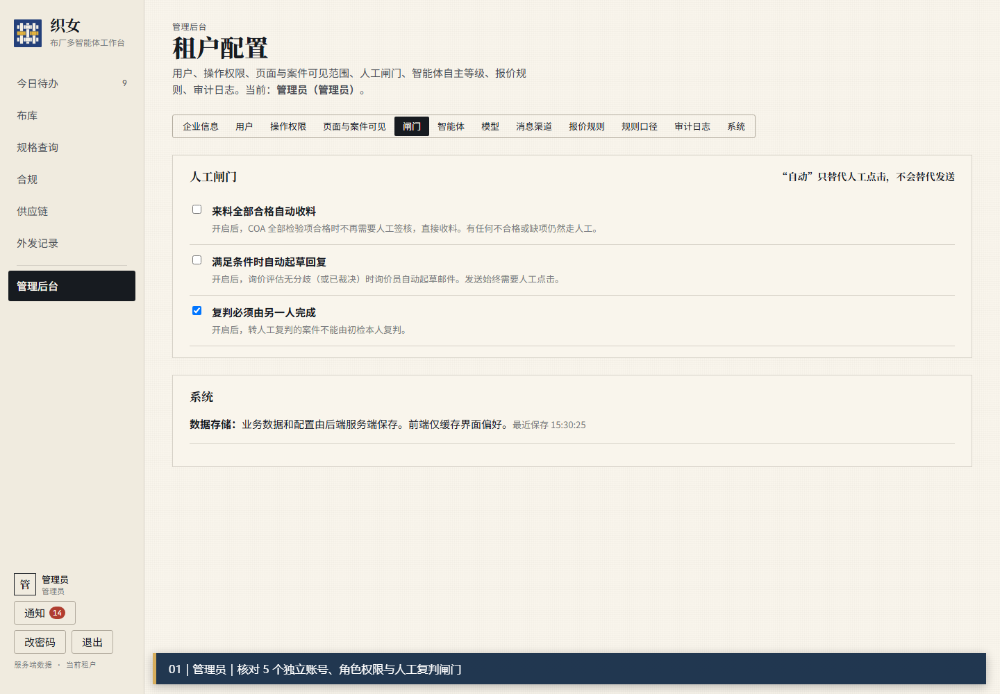
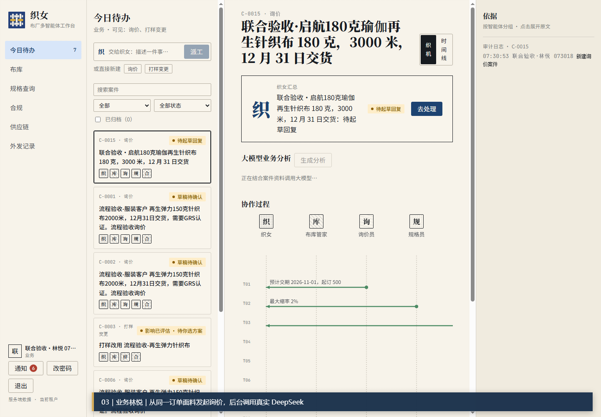
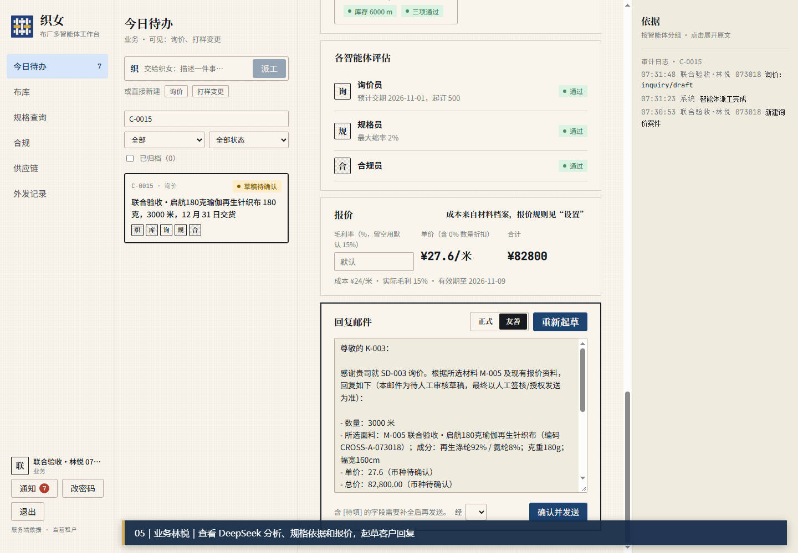
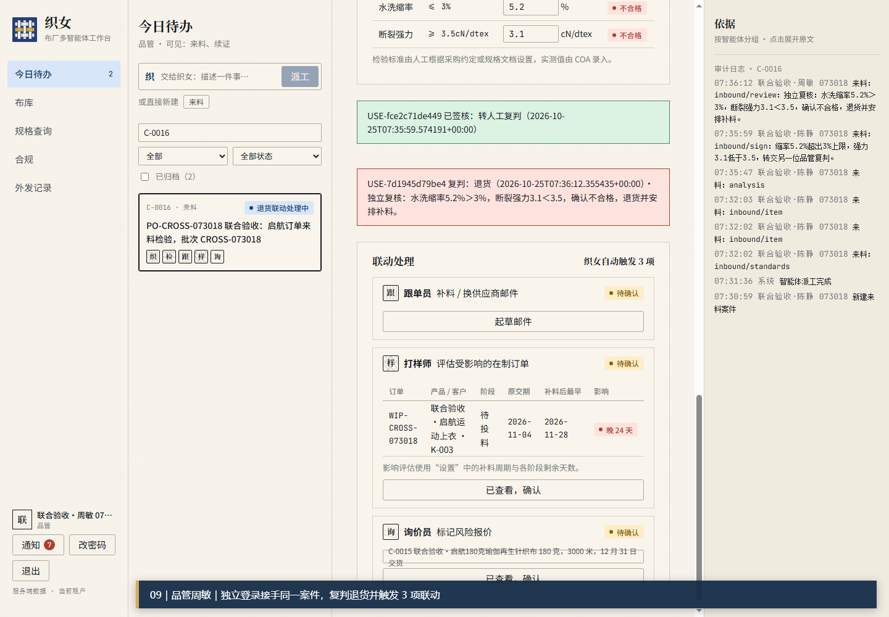
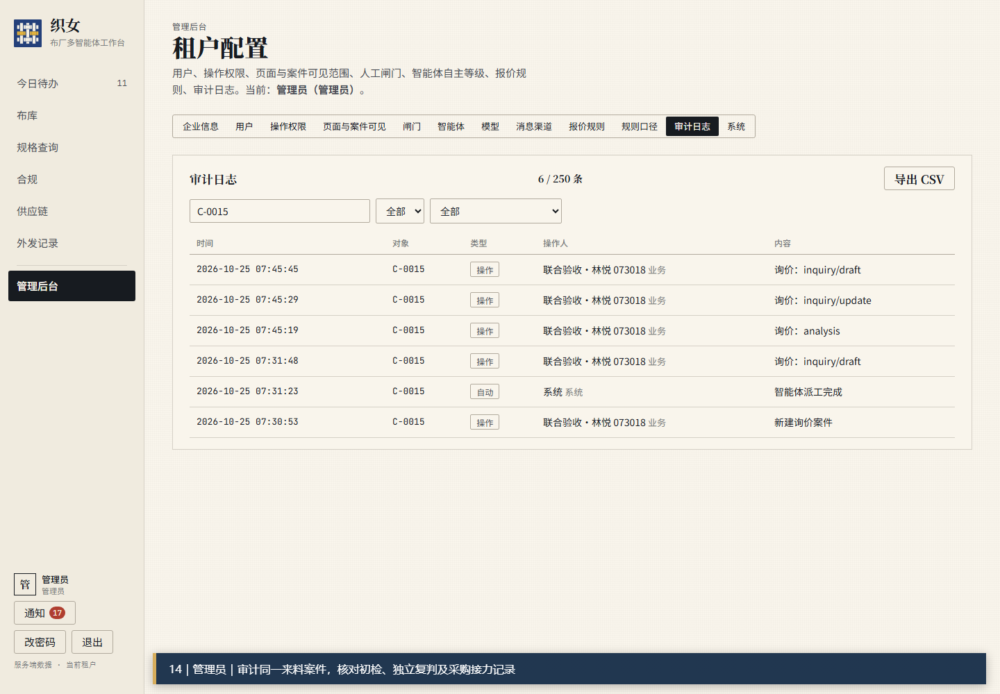

# 织女

### 多用户业务协同与智能运营工作台

让业务资料、跨角色协作、规则判断和大模型分析在同一条可追踪的工作链路中运行。

 

[观看演示视频](#演示视频) · [界面预览](#界面预览) · [技术实现](#技术实现) · [联系我](#联系)

## 一句话介绍

织女面向企业中需要多人协作处理业务的场景：采购建立事实，业务发起询价，品管完成检验和复判，系统根据规则传递影响，大模型在有资料依据的地方负责分析与起草，最后由真实责任人确认和留痕。

它展示的是一条完整的业务链路，而不是一个孤立的聊天窗口。

## 产品概览

织女把组织身份、今日待办、业务案例、供应链信息、质量检验、报价风险、智能分析和审计记录放在同一工作台中。每个角色只看到自己负责的工作，同时能够沿着同一个案件查看上下游影响。

系统把三类职责明确分开：

| 职责 | 系统中的作用 |
| --- | --- |
| 大模型 | 理解业务资料，解释风险，生成可编辑的询价、客户回复和补料邮件草稿 |
| 业务规则 | 计算报价、判断检验阈值、推导延期影响、校验角色权限 |
| 人工角色 | 录入事实、选择方案、完成签核、独立复判，并决定是否发送外部消息 |

这种分工让模型有明确边界：它可以帮助业务人员更快理解和组织信息，但不能替代权限校验、规则计算或人工审批。

## 一次完整的跨角色流程

<table>
<tr>
<td width="20%"><b>01 · 管理</b> 配置 5 个独立账号、角色权限和人工复判闸门</td>
<td width="20%"><b>02 · 采购</b> 建立采购单、供应商、数量、交期和关联订单</td>
<td width="20%"><b>03 · 业务</b> 发起询价并查看规格、认证、报价和风险分析</td>
<td width="20%"><b>04 · 品管</b> 录入实测数据，复判退货并触发业务联动</td>
<td width="20%"><b>05 · 接力</b> 采购、业务和管理员继续处理、重算和审计</td>
</tr>
</table>

### 关键结果

- 5 个独立登录会话：管理员、业务、采购、品管初检、品管复判
- 15 个按业务顺序验收的步骤，覆盖同案跨角色协作
- 7 次真实 DeepSeek 调用：询价分析、来料分析、客户回复和补料邮件
- 713 个 API 请求，非预期失败响应为 0，浏览器异常为 0
- 初检人员本人尝试复判时由后端拒绝，验证职责分离规则有效
- 补料邮件和客户回复保留为草稿，未经人工确认不会对外发送

## 界面预览

### 管理后台：先定义边界

管理员统一配置用户、操作权限、页面与案例可见范围、智能体、模型和消息渠道。人工复判闸门由后端校验，不由模型决定。

### 业务案例：同一案件连接多个角色

品管将标准和实测值写入案件后，系统保留检验依据；DeepSeek 根据已保存的业务资料解释质量和交期风险。

### 业务流程证据

<table>
<tr>
<td></td>
<td></td>
</tr>
<tr>
<td align="center">采购单与询价建立</td>
<td align="center">询价风险分析与回复草稿</td>
</tr>
<tr>
<td></td>
<td></td>
</tr>
<tr>
<td align="center">另一位品管独立复判</td>
<td align="center">管理员核对跨角色审计记录</td>
</tr>
</table>

<b>查看 15 个验收步骤</b>

| 步骤 | 角色 | 业务动作 | 模型 / 规则 / 人工边界 |
| --- | --- | --- | --- |
| 01 | 管理员 | 核对账号、权限和复判闸门 | 权限由后端校验 |
| 02 | 采购 | 建立客户订单关联的采购单 | 业务资料由采购录入 |
| 03 | 业务 | 发起询价并调用 DeepSeek | 模型分析有资料依据 |
| 04 | 品管 | 发起来料检验案件 | 缺失证据提示待确认 |
| 05 | 业务 | 查看风险分析并起草回复 | 报价由规则计算，草稿需人工审核 |
| 06 | 品管 | 录入标准与不合格实测值 | 阈值判断由确定规则完成 |
| 07 | 品管 | 根据实测数据重新分析 | 模型解释质量和交期风险 |
| 08 | 品管 | 转交复判，本人复判被阻止 | 后端验证职责分离 |
| 09 | 品管 | 独立复判退货并触发联动 | 退货由人工签核 |
| 10 | 采购 | 查看延期影响与风险报价 | 跨角色状态由系统保存 |
| 11 | 采购 | 生成补料邮件草稿 | 模型只起草，不自动发送 |
| 12 | 业务 | 收到退货风险并重新分析 | 模型解释新增风险影响 |
| 13 | 业务 | 换料、重算报价并生成回复 | 选料由人，金额由规则计算 |
| 14 | 管理员 | 审计初检、复判和采购接力 | 真实用户、时间和动作可追溯 |
| 15 | 验收 | 汇总模型调用和人工边界 | 5 个会话、7 次调用、外发未执行 |

## 演示视频

点击下方封面观看完整演示（3 分 19 秒，1920×1080）。视频无配音，右侧讲解栏按 15 个步骤说明输入资料、模型输出，以及规则和人工各自承担的职责。

<a href="https://github.com/916241958/zhinv-project/blob/main/zhinv-demo.mp4">▶ 在线播放演示视频</a> · <a href="https://github.com/916241958/zhinv-project/raw/main/zhinv-demo.mp4">下载 MP4（约 28.7 MB）</a>

## 技术实现

| 层 | 技术 |
| --- | --- |
| 后端 | Python · FastAPI（异步）· SQLAlchemy 2 · Alembic 迁移 · SSE 流式输出 · APScheduler |
| 数据 | PostgreSQL（asyncpg），本地开发可用 SQLite |
| 安全 | JWT 鉴权 · Argon2 密码哈希 · 敏感配置加密 · 后端统一权限与职责分离校验 |
| 前端 | Vue 3 · Vite · pdf.js 资料预览 |
| 模型 | DeepSeek，经后端统一编排；模型只负责分析与起草，不参与权限和金额计算 |
| 部署 | Docker / docker-compose |

设计上采用模块化单体：业务规则、权限校验和审计在后端确定性执行，大模型作为受控的分析组件接入，每次调用的输入资料与输出都可追溯。

## 项目边界

本仓库用于展示织女的产品理念、界面形态和业务演示，不公开完整源代码。演示数据为专门录入的验收数据，不作为实际订单或认证凭证；未配置的消息渠道不会进行外发。

## 项目状态

当前版本为产品概念与功能演示版本，持续完善中。

## 联系

如果你对产品合作、试用或这个项目的实现细节感兴趣，欢迎联系：

- GitHub：[@916241958](https://github.com/916241958)
- 邮箱：<!-- TODO: 填写你的邮箱 -->
