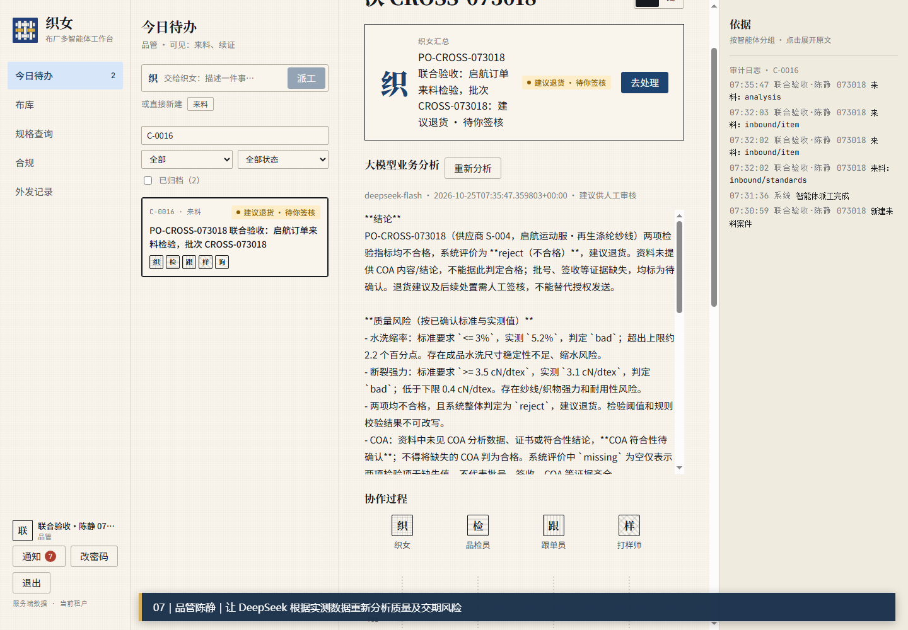

# 织女

**多用户业务协同与智能运营工作台**

把组织协作、业务案例和大模型分析放进同一个可追踪的工作空间。

<a href="https://github.com/916241958/zhinv-project/releases">演示资料</a> · <a href="#产品概览">产品概览</a> · <a href="#界面预览">界面预览</a>

 

## 产品概览

织女面向需要多人协同处理业务的企业场景。系统把组织身份、待办事项、业务案例、协作过程、规则判断和智能分析串联起来，让每一次处理都有上下文、有依据、可复盘。

它关注的不只是把大模型接入页面，而是让模型在业务流程中承担明确的辅助工作：整理信息、识别风险、给出分析建议，并把需要人工确认的环节清楚地交还给业务人员。

## 业务闭环

<table>
<tr>
<td width="25%"><b>01 · 进入业务</b> 按角色查看待办和可见案例</td>
<td width="25%"><b>02 · 协同处理</b> 围绕同一案例完成交接与复核</td>
<td width="25%"><b>03 · 智能分析</b> 基于业务资料生成分析和风险提示</td>
<td width="25%"><b>04 · 留痕复盘</b> 保留依据、动作与审计记录</td>
</tr>
</table>

## 核心能力

| 模块 | 能力说明 |
| --- | --- |
| 业务工作台 | 汇总今日待办、业务案例和处理状态，支持按条件筛选 |
| 多用户协作 | 根据组织身份和操作权限分配任务，支持交接与复核 |
| 业务案例 | 记录从进入、处理到结论的完整上下文 |
| 大模型分析 | 对业务资料进行归纳、判断和风险提示，辅助人工决策 |
| 规则与审计 | 将业务规则、人工确认和操作记录集中管理 |
| 系统配置 | 管理租户、用户、智能体、模型和消息渠道 |

## 界面预览

### 业务管理与权限控制

管理后台集中配置用户、操作权限、页面可见范围、智能体和业务规则，为多人协作提供统一边界。

### 案例协同与大模型分析

业务人员在案例上下文中查看大模型分析结果、风险依据、协作成员和审计记录，并对建议进行人工确认。

## 演示视频

<video controls width="880">
  <source src="https://github.com/916241958/zhinv-project/raw/refs/heads/main/zhinv-demo.mp4" type="video/mp4">
</video>

 

<a href="https://github.com/916241958/zhinv-project/raw/refs/heads/main/zhinv-demo.mp4">打开或下载完整演示视频</a>

视频展示多用户业务交叉处理过程，以及大模型在业务分析和风险识别中的辅助作用。

## 项目定位

本仓库用于展示织女的产品理念、界面形态和业务演示。完整源代码不在本仓库公开。

## 项目状态

当前版本为产品概念与功能演示版本，持续完善中。
